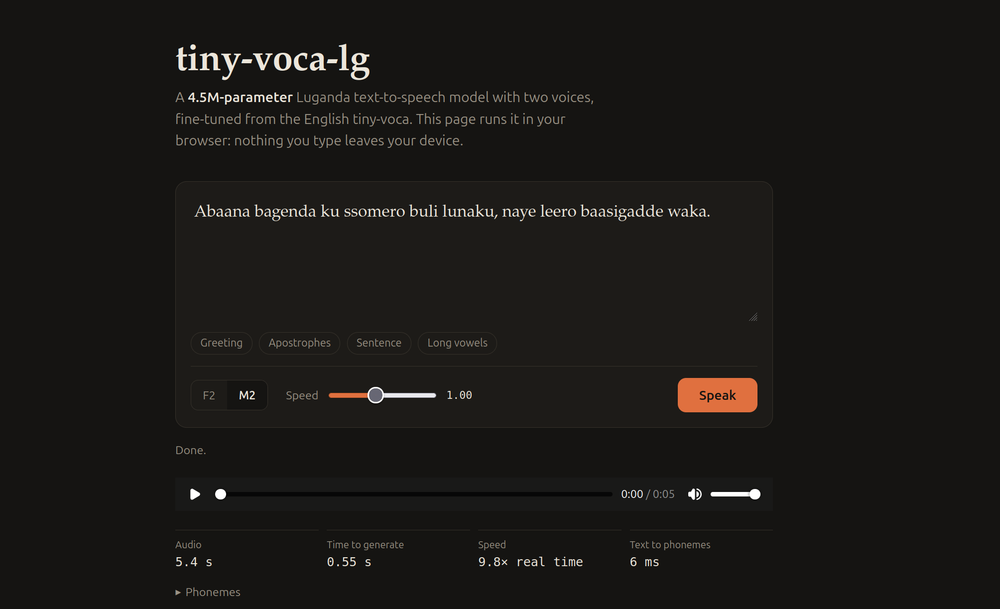

<div align=center>

# tiny-voca-lg

[](#how-luganda-is-read)
[](https://huggingface.co/henryhale/tiny-voca-lg)
[](#onnx)

[](LICENSE)
[](#licences)
[](https://huggingface.co/henryhale/tiny-voca-lg)
[](https://huggingface.co/n4ze3m/tiny-voca)
[](https://huggingface.co/datasets/CraneAILabs/waxal-lug-clean)

A small Luganda text-to-speech model: [tiny-voca](https://github.com/n4ze3m/tiny-voca)
(4.5M parameters) fine-tuned on recorded Luganda speech. Two voices, F2 and M2,
24 kHz. Runs on a CPU or in the browser.

**[Try the demo](https://henryhale.github.io/tiny-voca-lg/)** 🚀

[](https://henryhale.github.io/tiny-voca-lg/)

</div>

## Quick start

```bash
git clone https://github.com/henryhale/tiny-voca-lg.git
cd tiny-voca-lg
pip install -e .
hf download henryhale/tiny-voca-lg --local-dir weights

python -m tiny_voca.infer --checkpoint weights/tiny-voca-lug.pt \
  --voice F2 --text "Oli otya? Nkwagala nnyo, ssebo." --output out.wav
```

Options: `--voice F2|M2`, `--speed`, `--pitch-shift`, `--pitch-range`, `--text-file`.
Long text is read sentence by sentence.

From Python:

```python
from tiny_voca.text import set_frontend
set_frontend("lug")             # or set TINY_VOCA_FRONTEND=lug

import soundfile as sf
from tiny_voca.infer import load_model, speak_text

model = load_model("weights/tiny-voca-lug.pt")
wave, _ = speak_text(model, "Webale nnyo okujja. Weeraba!", "M2")
sf.write("out.wav", wave.numpy(), 24000)
```

## How Luganda is read

[`lug.py`](src/tiny_voca/lug.py) turns spelling into phonemes with simple rules.
No dictionary or phonemizer is needed.

| Spelling | Phonemes | Example |
|---|---|---|
| a e i o u | ɐ ɛ i ɔ ʊ | *bala* → b ɐ l ɐ |
| aa ee ii oo uu | ɑː eɪ iː oː uː | *kitaawe* → k i t ɑː w ɛ |
| double consonant | doubled | *bajja* → b ɐ dʒ dʒ ɐ |
| ny, ng' | n j, ŋ | *ng'ombe* → ŋ ɔ m b ɛ |
| ky, gy, r | tʃ, dʒ, ɾ | |

Tone is not modelled. The rules are part of the checkpoint, so changing them
means retraining.

Before the rules run, [`lug_text.py`](src/tiny_voca/lug_text.py) writes out in
Luganda words what the rules cannot read. It is not part of the checkpoint, so
it can change without retraining:

| Written | Read as |
|---|---|
| 2026 | enkumi bbiri mu amakumi abiri mu mukaaga |
| 3.5 | ssatu pointi ttaano |
| Shs 5,000, 5,000/=, UGX 5,000 | siringi enkumi ttaano |
| $20 | doola amakumi abiri |
| 50% | ebitundu amakumi ataano ku kikumi |
| 10:30 | essaawa nnya n'ekitundu (Luganda time, six hours on) |
| essaawa 2:15 | essaawa bbiri n'eddakiika kkumi na ttaano (already Luganda time) |
| 0772 123456, +256 ... | digit by digit |
| Dr., Prof., Owek. | dokita, pulofeesa, owekitiibwa |
| NRM, KCCA | enu aa emu, kke ssi ssi ee (2-5 capitals, unless all the text is in capitals) |
| OK, TV, WhatsApp, ... | okee, ttivvi, wasaapu (a short list of loanwords: `RESPELLINGS`) |

Numbers are in the counting form, which agrees with nouns like *ente* and
*essaawa*; with other nouns it does not agree (*abantu 3* is read *abantu
ssatu*, not *abantu basatu*).

## ONNX

`model.onnx` and `model.json` are in the [weights repository](https://huggingface.co/henryhale/tiny-voca-lg).
To export your own: `python -m tiny_voca.export --checkpoint weights/tiny-voca-lug.pt --output model.onnx`

Run it from Python:

```python
import numpy as np
import onnxruntime as ort
import soundfile as sf
from tiny_voca.text import phonemize, set_frontend

set_frontend("lug")
phones = phonemize("Oli otya? Nkwagala nnyo.")
one = lambda value: np.array([value], dtype=np.float32)

session = ort.InferenceSession("weights/model.onnx")
audio, _ = session.run(None, {
    "tokens": np.array([phones.ids], dtype=np.int64),
    "stress": np.array([phones.stress], dtype=np.int64),
    "voice": np.array([0], dtype=np.int64),      # 0 = F2, 1 = M2
    "speed": one(1.0), "pitch_shift": one(0.0), "pitch_range": one(1.0),
})
audio = audio[0] * min(1.0, 0.99 / np.abs(audio).max())
sf.write("out.wav", audio, 24000)
```

One call reads one sentence (up to 512 tokens).

## Web demo

[`web/`](web/) runs the model in the browser, with a JavaScript copy of the
front end ([`lug.js`](web/public/lug.js)). Pick a model file:

- **GGUF** (3.3–18.2 MB): runs in plain JavaScript ([`tiny-voca.js`](web/public/tiny-voca.js)), no runtime.
- **ONNX** (21 MB): runs in ONNX Runtime Web, faster.

```bash
cd web/public && python3 -m http.server 8000
```

The same GGUF code runs from the command line with Node or Bun:

```bash
node js/say.mjs "Oli otya? Nkwagala nnyo." --voice F2 --output out.wav
```

To make the GGUF files: `python scripts/export_gguf.py --checkpoint weights/tiny-voca-lug.pt`.

## Training

To train on Kaggle with two free T4 GPUs, see [notebooks/](notebooks/).

Command-line steps:

```bash
pip install -e ".[data,prepare,annotate]"
export TINY_VOCA_FRONTEND=lug
hf download n4ze3m/tiny-voca tiny-voca.pt --local-dir english

# 1. Export speakers 5 (F2) and 1 (M2) at 24 kHz
python scripts/export_waxal.py --output data

# 2. Cut recordings into 4-18 s chunks
python scripts/split_clips.py --clips data/clips-5.jsonl --output data/chunks-5
python scripts/split_clips.py --clips data/clips-1.jsonl --output data/chunks-1

# 3. Choose 100 minutes per voice, split off validation
python scripts/make_manifests.py --data data

# 4. Features
python -m tiny_voca.prepare --inputs data/train.jsonl --split train --output features
python -m tiny_voca.prepare --inputs data/validation.jsonl --split validation --output features

# 5. Alignment
python -m tiny_voca.annotate --features features --output annotations \
  --dataset-revision CraneAILabs/waxal-lug-clean --splits train validation \
  --min-token-probability 0.35 --max-weak-phone-fraction 0.5 --max-phone-frames 90

# 6. Fine-tune (two GPUs; on one, use python -m tiny_voca.train)
torchrun --standalone --nproc_per_node 2 -m tiny_voca.train \
  --train annotations/train.jsonl --validation annotations/validation.jsonl \
  --output runs/lug --init-weights english/tiny-voca.pt \
  --steps 4000 --learning-rate 2e-4 --warmup 300 \
  --gan-start 1000 --gan-ramp 1000 \
  --teacher-hold 500 --teacher-ramp 1500 --teacher-final 0 \
  --batch-frames 9000 --save-every 500 --keep-every 1000 --log-every 50

# 7. Export
python scripts/export_checkpoint.py --checkpoint runs/lug/step-00004000.pt --output tiny-voca-lug.pt
python -m tiny_voca.export --checkpoint tiny-voca-lug.pt --output model.onnx

# 8. GGUF files (f32, f16, q8_0, q4_0)
python scripts/export_gguf.py --checkpoint tiny-voca-lug.pt --output-dir gguf
```

Every step can be restarted; training continues with `--resume runs/lug/last.pt`.
Out of GPU memory: `--batch-frames 6000`.

## Tests

```bash
PYTHONPATH=src:tests python -m unittest discover -s tests
```

## Limits

- The front end reads Latin letters only; other scripts are skipped.
- Tone is not written in Luganda spelling, so the rules cannot mark it.
- Numbers are read in the counting form, without agreeing with the noun; ordinals (1st, 2nd) are not handled.
- Loanwords and names are read with the same Luganda rules, apart from the short list in `lug_text.py`.
- An initialism is spelled out only when it is 2-5 capital letters and the text is not all in capitals.
- The rule tables are part of the checkpoint: changing them means retraining.
- One model call reads one sentence (up to 512 tokens); `speak_text` splits longer text.

For the limits of the released model, see the [model card](https://huggingface.co/henryhale/tiny-voca-lg).

## Licences

| What | Licence |
|---|---|
| Code in this repository, including the Luganda front end (`lug.py`, `lug.js`) | [Apache-2.0](LICENSE) |
| Released weights: checkpoint, `model.onnx`, `model.json`, GGUF files | [CC BY-SA 4.0](https://creativecommons.org/licenses/by-sa/4.0/) |
| Training recordings (not distributed here) | [CC BY-SA 4.0](https://creativecommons.org/licenses/by-sa/4.0/) |

The voices were learned from the Luganda TTS recordings of
[WaxalNLP](https://huggingface.co/datasets/google/WaxalNLP), which lists them
under CC BY-SA 4.0. Training used the cleaned copy
[CraneAILabs/waxal-lug-clean](https://huggingface.co/datasets/CraneAILabs/waxal-lug-clean):
the same recordings, so the same licence, although its card says CC BY 4.0.
The weights are therefore released under CC BY-SA 4.0 too. They are fine-tuned
from [n4ze3m/tiny-voca](https://huggingface.co/n4ze3m/tiny-voca) (Apache-2.0),
whose notice is kept.

To redistribute the weights, include the CC BY-SA 4.0 licence, keep any
changed weights under the same licence, and give this attribution:

> tiny-voca-lg by Henry Hale, fine-tuned from tiny-voca by Muhammed Nazeem
> (Apache-2.0), on Luganda recordings from WaxalNLP (Makerere University,
> Loud and Clear; CC BY-SA 4.0).

The two voices are those of two recorded WaxalNLP speakers. Do not use them to
impersonate those speakers.

## Credits

- [tiny-voca](https://github.com/n4ze3m/tiny-voca) by Muhammed Nazeem: model, code and English weights (Apache-2.0).
- [WaxalNLP](https://huggingface.co/datasets/google/WaxalNLP): Luganda recordings by Makerere University and Loud and Clear, funded by Google and the Gates Foundation (CC BY-SA 4.0).
- [CraneAILabs/waxal-lug-clean](https://huggingface.co/datasets/CraneAILabs/waxal-lug-clean): the cleaned copy used for training.

If you use this, please cite upstream tiny-voca:

```bibtex
@software{nazeem2026tinyvoca,
  author = {Nazeem, Muhammed},
  title  = {tiny-voca: a 4.5M-parameter two-voice English text-to-speech model},
  year   = {2026},
  url    = {https://huggingface.co/n4ze3m/tiny-voca}
}
```

